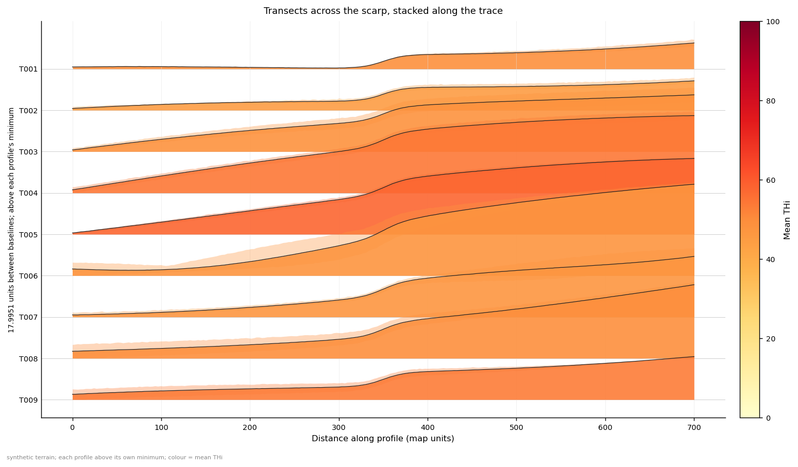
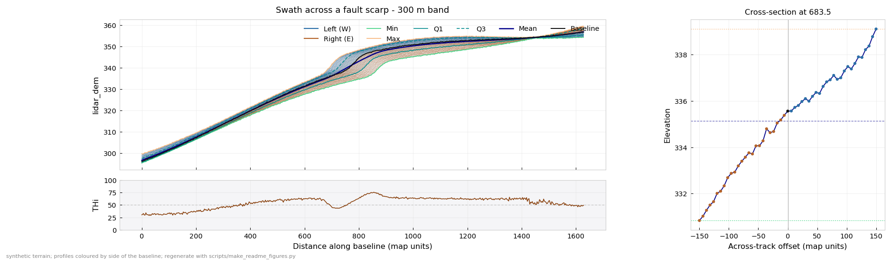

# Swath Profile for ArcGIS Pro

[](https://github.com/james-lagreca/swath-profile-arcgis-pro/actions/workflows/ci.yml)
[](LICENSE)


Draw a line on the map — or give a fault trace and a spacing — pick a DEM, click
Run: an interactive swath profile with per‑station minimum, maximum, mean,
median, quartiles and chosen percentiles, local relief, hypsometric integral
(HI) and the terrain hypsometric index (THi / THi\*), linked to the map.





*Figures from synthetic terrain (`scripts/make_readme_figures.py`).*

**Features**

- Baselines drawn on the map, taken from a layer, or placed automatically as
  transects along a fault trace (with their own swath width).
- Offset‑line sampling (the published method, keeps the profile family) or
  all‑cells sampling (exact envelope), in any coordinate system.
- Chart window that stays open across runs: cross‑sections, measurements,
  re‑zero at the fault, detrend, overlay or stacked ridgeline of several
  profiles, publication presets.
- A browser chart with every run: one offline HTML file that needs no Python,
  for computers whose security software blocks the chart window and for
  colleagues without ArcGIS.
- Profile lines colourable by which side of the baseline they came from, in the
  chart and on the offset‑lines layer in the map, with the compass direction of
  each side named in the legend.
- A sampling mask, drawn or from a polygon layer, to measure one surface only:
  a fan without the bedrock beside it. The map outputs are cut to match.
- Map outputs with a native chart linked to map selection; hover help on every
  parameter; a time estimate before you press Run.
- Seventeen documented numerical fixes over the reference implementations, with
  a *Legacy statistics* switch to reproduce published numbers.

A port of the Pérez‑Peña et al. (2017) *SwathProfiler* method to arcpy/numpy, by
way of the QGIS re‑implementation. See [docs/ALGORITHM.md](docs/ALGORITHM.md) for
the formulas, the verified raster conventions and the seventeen numerical
defects this port fixes, and [docs/PARAMETERS.md](docs/PARAMETERS.md) for every
parameter (the same text appears when you hover a parameter in Pro).

A swath profile summarises a raster inside a band of finite width, so a single
drainage or a data artefact cannot dominate the picture the way it can on a
single-line profile — which is why swaths are the standard way to show
topographic signal across a structure such as a fault trace.

## Requirements

ArcGIS Pro 3.x. No extensions — everything runs on core arcpy plus
numpy/scipy/matplotlib, all in the stock `arcgispro-py3` environment.

## Install

Download the [latest release](https://github.com/james-lagreca/swath-profile-arcgis-pro/releases)
ZIP (or `git clone https://github.com/james-lagreca/swath-profile-arcgis-pro`),
unzip it anywhere, and add `SwathProfile.pyt` to a project (*Catalog →
Toolboxes → Add Toolbox*). One toolbox, one tool; nothing to build or register.
If you update the folder while Pro is open, restart Pro: it caches the tool's
Python.

In the Catalog pane, *Remove* takes the toolbox out of the project; *Delete*
deletes the file from disk.

## Three ways to run it

1. **Draw.** Click the sketch tool beside *Draw Baseline on Map*, draw a line,
   double‑click to finish, Run.
2. **Layer.** Pick a line layer in *...or Baseline Layer* (a map selection is
   honoured). Optionally choose a *Baseline Label Field* so profiles carry a
   name.
3. **Transects.** Under *Transects along a trace*, give a fault trace, a spacing
   and a length. The tool places perpendicular transects along it, numbered
   `T001, T002, …`, writes them as a labelled layer, and profiles every one —
   optionally with their own swath width, different from any drawn baseline in
   the same run. With several profiles the saved charts include a stacked
   ridgeline figure of all of them.

Then pick one or more rasters (DEM first) and a swath width. Everything else
has a default. Outputs land in `swath_results\swath_results.gdb` in the project
folder, named after the baseline source and a timestamp; nothing is
overwritten. They deliberately avoid the project's own geodatabase: creating a
dataset in a geodatabase that has unsaved edits blocks until the edits are
saved, which looks like the tool hanging at "Writing outputs". If a run would
take more than a couple of minutes, the dialog says so before you press Run.

### Measuring one surface only: the sampling mask

A swath across an alluvial fan often clips the bedrock range front at one
corner, and those cells drag the minimum, the relief and THi away from the
fan. Under *Sampling mask*, draw a polygon round the fan, or pick a polygon
layer of mapped units (a selection is honoured; drawn and layer polygons are
merged). With *Exclude inside* you can instead draw round just the part to
leave out.

Samples and cells outside the mask count as missing, exactly like NoData:
nothing outside ever enters a statistic or the smoothing. The swath band and
the offset lines on the map are cut to what was actually sampled, the run
reports how much of each band the mask kept (`MASK_KEPT` in the summary), and
the chart window and saved charts say a mask was used. Stations at the edge of
the mask can keep only a sliver of the band; raise *Minimum Valid Samples per
Station* to leave those out. Masking changes the relief each station sees, so
it changes HI and THi as well, which is the point of measuring one surface.

The mask adds no geoprocessing calls, so it costs nothing in a slow project.
The same result can be had without the tool by clipping the DEM first with
*Clip Raster*, at the cost of writing a copy of the raster. An automatic mask
by slope was deliberately not added: it would also remove the fault scarps you
are measuring.

## What you get on the map

- **Swath band** — the polygon actually sampled, drawn with a transparent fill.
  With a sampling mask it is cut to the area the mask kept.
- **Station points** — one point per station carrying every statistic as an
  attribute (prefixed by raster, e.g. `MEADOWS_MEAN`, `MEADOWS_THI`), with a
  **native line chart attached**. Because the chart sits on a feature layer,
  Pro links it to the map: brush a stretch of the chart and those stations
  highlight; select stations on the map and the chart follows. Symbolise the
  layer by THi or relief for a map view of the profile.
- **Transects** (when a trace was given), labelled with their names.
- The **statistics table**, and optionally the offset lines, Z‑enabled 3D
  profile lines, a summary table with provenance, CSVs and chart files.

## The chart window

Opens on its own and **stays open**: every later run adds its profiles to the
list, so you can draw line after line and compare. Its maths lives in
`swathprofile/transforms.py` and is unit‑tested; the window is only the shell.

| | |
|---|---|
| **Profiles** | Every profile from every run this session. Select one to view it; select several to **stack** them (a ridgeline: each profile above its own floor, in order along the trace, later ones in front — the natural figure for a set of transects) or **overlay** their means on one axis. Stack options: which series, alignment (own minimum / own mean / absolute), colour by mean THi or elevation, band shading, spacing. `Open…` loads saved results, several at once. |
| **Click the chart** | Pins a station and shows its **cross‑section** — elevation across the band at that spot — in the right‑hand panel. `←`/`→` step along. |
| **Measure** (`M`) | Two clicks → Δdistance, Δelevation, gradient and angle, read from the series you choose (mean by default). Scarp heights straight off the swath. Measurements are annotated on the chart and exported with the CSV. |
| **Distance axis** | Type an origin or `Pick` one on the chart (`O`) so distance is zero at the fault; `Flip direction` to read across strike consistently. The cross‑section mirrors with it. |
| **Detrend** | *Linear detrend* removes the regional slope from every series so a scarp on a sloping piedmont stands out; *Relative to minimum* expresses the swath above its floor. |
| **Series** | Profile family, Min/Max, the percentile band, Q1/Q3, Mean, Median, the **baseline's own profile** (dark line — the classic single‑line profile, read against the band it sits in), Relief on a right axis. |
| **Colour by** (under *Profile lines*) | Colour the individual profiles by **which side of the baseline** they came from, so an asymmetric range front or valley reads at a glance. *Side + distance* also fades each colour in towards the line, showing how far out a profile sits. The legend names the compass point each side faces (`Left (W)`, `Right (E)`), because left and right depend on the direction you drew the line; on a baseline too curved for one bearing the compass is omitted. Offset‑lines sampling only. |
| **Smoothing** | Savitzky–Golay presets, re‑applied live to the raw samples. |
| **Vertical exaggeration** | Live *VE ≈ n×* readout in the status bar; set a VE or tick *Equal aspect*. |
| **THi panel** | Show/hide; enhanced THi\*. Raster panels can be hidden individually. |
| **File → Export chart image** | Presets *Screen*, *Journal single column* (85 mm), *Journal double column* (170 mm), *Poster*; PNG/PDF/SVG with editable text; optional cross‑section and THi panels. |
| **File → Export CSV** | The current profile as shown (with re‑zeroed distance), plus a measurements file if any. |
| **File → Show results folder** | Opens the folder of saved results. |

`SwathViewer.cmd` opens the viewer without starting ArcGIS Pro — drag a
`.swath.npz` result onto it, or run it and pick one. It still uses ArcGIS Pro's
Python, so it needs Pro installed. Every run keeps a permanent copy of its
result in `<project folder>\swath_results\`.

Why a separate window: ArcGIS Pro owns its process's UI thread, so a chart
window inside a running Python tool would freeze Pro, and Qt is not present in
`arcgispro-py3`. The chart↔map link is provided by the native chart on the
station points instead.

### The browser chart, and computers that block the chart window

Every run also writes a **browser chart**: `<table name>.html` beside the saved
result in `swath_results`. It is one self-contained file that opens in Edge,
Chrome, Firefox or Safari, needs no Python, no internet and nothing installed,
and can be emailed to someone without ArcGIS. It has the profile list, the
swath envelope with the same series toggles and side colours as the window,
the THi panel, a readout on hover, the cross‑section at a clicked station
(arrow keys step along), drag‑to‑zoom, and PNG or SVG export with the title and
the same provenance footer as the saved charts. It is a snapshot of one run,
and each run opens in a new browser tab; the chart window remains the place to
compare runs, smooth, measure, re‑zero, detrend and stack. Every profile line
is drawn, however many there are; on lines with far more stations than the
screen has pixels, only the points that can show are drawn, so the picture is
unchanged.

The page is typically a few megabytes, and the run reports its size and warns
when it is too big for most email. It keeps every profile line of every
profile unless that would make it larger than browsers open comfortably,
about 150 MB, which takes something like hundreds of transects on LiDAR. Only
then are lines left out, as few as possible, and the page and the run both
say so; the statistics are always all there. Some email systems block or
quarantine HTML attachments with scripts in them: zip the page, or share it
through a folder.

Some organisations run security software that lets only approved programs
start (Airlock Digital, AppLocker, WDAC and similar). The toolbox itself is
unaffected, because it runs inside ArcGIS Pro, but the chart window is a
separate Python program and can be blocked, as can `SwathViewer.cmd`. The tool
checks that the window really started. If it did not, it says so, opens the
browser chart instead, and remembers, so that computer is not asked again (each
attempt would raise another notice, and such systems usually log every block
for IT). *Show Interactive Chart* controls this:

| | |
|---|---|
| **Automatic** (default) | The chart window, or the browser chart where the window can't run. |
| **Chart window** | Always try the window, for example after IT has approved it; still falls back. |
| **Browser page** | Open the browser chart and never start the window. |
| **Off** | Show nothing. The browser chart is still written. |

To get the window on such a computer, ask IT to approve the toolbox's `viewer`
folder, then choose *Chart window* once. Approval by file hash would need
renewing after every update of the tool, because the hash changes. If ArcGIS
Pro uses a cloned Python environment, that environment's `pythonw.exe` may need
approving as well. Ask IT rather than moving the toolbox into a folder that
happens to be approved already; the tool itself never tries to get the window
past such a block.

From the tool's side a block and some other start‑up faults look the same, so
its messages say what happened rather than guess why. A window that starts and
then closes is treated as a fault, not a block, and is tried again in the next
Pro session.

The tool never touches the map while it runs, and it makes as few
geoprocessing‑tool calls as possible. Inside a large Pro project every
geoprocessing call (`CreateTable`, `AddFields`, `CopyRows`, `GetCount`…) was
measured at 20–35 seconds regardless of what it did, so a run whose computation
took 6 s spent 6 minutes writing. Tables and the station points are therefore
written with `arcpy.da` (no geoprocessing framework), polygon and line outputs
come from a cached template in one call, and styling, labels and the native
chart are plain‑JSON layer files (`swath_results\layer_files\`) attached to the
outputs, which Pro applies when it adds them afterwards. Adding layers from
inside a tool is avoided for the same reason: each add forces a map redraw.

## Slow in a large project?

Symptoms: the computation finishes in seconds (the messages are time‑stamped),
but each *write* step takes 20–100 s, and Pro shows "updating" for a long time
after *Done*. The tool's own work is not the problem: the same steps take a
fraction of a second in a small project.

Cause: every call that goes through Pro's geoprocessing framework — even a
trivial `AddFields` — makes Pro re‑validate the map and project, and it retries
any **layer whose data source is broken or slow** (the red "!" marker, or an
unreachable web service) every time. A handful of those turn each call into a
network timeout. The tool has been written to make almost no such calls
(tables and station points are written with `arcpy.da`, layer files are plain
JSON), but one remains per run — creating the band polygon's feature class —
and Pro's own post‑run adding of layers is affected too.

Remedies, in order:

1. **Repair or remove layers with a red "!"** in the map (right‑click → *Data →
   Repair Data Source*, or remove them). This fixes every tool in the project.
2. Confirm by running in a **new, blank map** with only the DEM and the baseline:
   if that is fast, the other map's layers were the cause.
3. Trim the project's **geoprocessing History** if it is very long.
4. Turn off **Add Outputs to Map** for quick looks; the chart window still opens.
5. Leave outputs in `swath_results.gdb` (the default): a geodatabase with
   unsaved edits blocks new datasets until the edits are saved.

## Coordinate systems

Lines and rasters may each be in any defined coordinate system, projected or
geographic. The swath is computed in a projected *working* system — the first
projected raster's; else the baseline's if projected; else a UTM zone chosen
from the baseline's centre — and sample points are transformed into each
raster's own system for sampling. Swath width and step are always ground
lengths. Set the datum transformation under *Advanced* if the list offers one;
the tool warns when it does.

## Sampling methods

*Offset lines* (classic) keeps the individual profile curves and matches the
published method, but on a fine DEM or a wide band most cells fall between the
lines — the tool tells you the fraction. *All cells* uses every raster cell in
the band for an exact envelope and percentiles; it has no individual curves.
Both use the same cross‑section construction, so they agree on curves as well
as straight lines. See ALGORITHM.md for the two discrete effects visible in
`N_VALID` and the extremes in All‑cells mode.

## Outputs

**Statistics table** — one row per baseline part, raster and station:

```
LINE_OID, PART_ID, LINE_NAME, RASTER, STATION, DIST, X, Y,
Z_MIN, Z_MAX, Z_MEAN, Z_MEDIAN, Z_Q1, Z_Q3, Z_PLO, Z_PHI, Z_STD,
RELIEF, HI, THI, THI_RAW, THI_STAR, N_VALID, N_TOTAL, KAPPA, FOLDED
```

`Z_PLO`/`Z_PHI` are the chosen percentiles (default 5/95). `THI` has the relief
factor clamped (recommended); `THI_RAW` is the reference formula verbatim.
`N_VALID` is how many samples at that station were real data. Sketched
baselines get `LINE_OID` from 1 000 000 and transects from 2 000 000, so they
never collide with a layer's OIDs.

## Tests

```bash
"C:\Program Files\ArcGIS\Pro\bin\Python\envs\arcgispro-py3\python.exe" -m pytest tests -q
```

165 tests. Most assert against closed‑form answers on analytic surfaces — a
plane cross‑section has HI exactly 0.5 and THi exactly 50, bilinear
interpolation is exact on a plane, detrending a plane profile gives exactly
zero, transects on a circular trace are exactly radial — so a failure localises
the bug rather than merely signalling one. `test_tool_e2e.py` drives the
geoprocessing tool through its real parameter objects, transects included.
`test_core.py`, `test_transforms.py`, `test_mask.py`, `test_chartwindow.py`,
`test_webchart.py` and `test_webchart_render.py` run without ArcGIS and in CI; `test_mask.py` drives
the whole engine on an in-memory raster (`tests/fake_raster.py`), which is how
the sampling mask and the all-cells mode's block-size invariance are checked
there. `test_webchart_render.py` loads browser charts in headless Chrome or
Edge and drives them like a person would — hover, click, drag, keys, saving —
and is skipped when neither browser is installed. The page's pure JavaScript
has its own tests, run with Node:

```bash
node --test tests/js/webchart_core.test.js
```

### Trying transects in Pro

Pick any fault trace layer as *Trace to Place Transects Along* (under
*Transects along a trace*), set a spacing (e.g. 500 m) and a transect length
longer than the feature you want to see across (e.g. 3000 m), choose the DEM
and a swath width, Run. You get a labelled `swath_transects_…` layer, one band
per transect, `T001, T002, …` in the chart window's profile list, and every
output tagged with the transect name.

## Citing

Cite the method paper (below) and the software; `CITATION.cff` carries the
metadata GitHub uses for its *Cite this repository* button.

## Licence

GNU GPL v3 — see [LICENSE](LICENSE). The algorithm is a port of
`OpenQGIS/SwathProfile4QGIS`, which is released under the GPL v3, so this port
carries the same licence.

## Development

Set `SWATH_DEV_RELOAD=1` before starting Pro so edits to the package take
effect without reopening the project. After changing parameters or help text,
run `scripts/build_help.py` to regenerate the dialog help and
`docs/PARAMETERS.md`.

```
SwathProfile.pyt                 toolbox; thin, delegates to the package
SwathProfile.SwathProfileTool.pyt.xml   generated parameter help
SwathViewer.cmd                  open the viewer without Pro
tools/extract_swath_profile.py   the tool: parameters, validation, outputs, map, viewer
tools/help_text.py               parameter help (single source)
swathprofile/
  geometry.py     resample, tangents, normals, curvature, folds, transects  [no arcpy]
  sampling.py     grid conventions + vectorised interpolation              [no arcpy]
  stats.py        statistics, percentiles, HI, THi, the defect fixes       [no arcpy]
  smoothing.py    NaN-safe Savitzky-Golay                                  [no arcpy]
  transforms.py   detrend, re-zero/flip, cross-section, measure            [no arcpy]
  mask.py         sampling mask: point and cell tests, one crossing rule   [no arcpy]
  webchart.py     the browser chart: run data into one offline HTML page   [no arcpy]
  chartwindow.py  chart window or browser chart; detects a blocked window   [no arcpy]
  templates/webchart.html  the browser chart's page, CSS and JavaScript (no libraries)
  plotting.py     figure builder, overlay, presets                         [no arcpy]
  bundle.py       .swath.npz round trip (v2, reads v1)                     [no arcpy]
  config.py       run configuration + pre-run estimate                     [no arcpy]
  raster_io.py    window maths, NoData, tiling, env hygiene                [arcpy]
  features.py     CRS, baselines, masks, transects, station points, writers [arcpy]
  zonal.py        all-cells statistics (cross-section sweep)
  outputs.py      tables, CSV, native chart                                [arcpy]
  engine.py       orchestration + progress                                 [arcpy]
viewer/swath_viewer.py   the Tk viewer (separate process)
```

## Reference

Pérez‑Peña, J.V., Al‑Awabdeh, M., Azañón, J.M., Galve, J.P., Booth‑Rea, G. &
Notti, D. (2017). SwathProfiler and NProfiler: Two new ArcGIS Add‑ins for the
automatic extraction of swath and normalized river profiles. *Computers &
Geosciences* **104**, 135–150. https://doi.org/10.1016/j.cageo.2016.08.008
